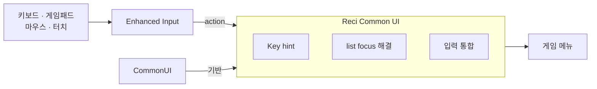

# Reci Common UI

[English](README.md) · 한국어


Reci Common UI는 CommonUI를 기반으로 입력을 통합하고 게임 메뉴 제작 구조를 제시하는 Unreal Engine 플러그인입니다.

- **입력 통합**: 키보드, 게임패드, 마우스, 터치가 같은 hover, focus, selection, confirmation 규칙으로 동작합니다.
  navigation은 Enhanced Input mapping을 따르고, key hint는 지금 쓰는 장치의 key를 보여 줍니다.
- **Composer → Screen 구조**: map마다 Composer 하나가 Stack과 UI input mapping을 맡고, Screen은 자기 화면의 표시,
  입력, 초기 focus만 맡습니다. 참조는 아래로만 향하고, 위로는 dispatcher로 요청합니다. 데모가 이 구조로 만들어져
  있습니다([SPEC.ko.md](Plugins/ReciCommonUI/SPEC.ko.md#구조)).
- **list focus 해결**: CommonUI의 ListView 기반 list는 entry widget을 재활용하므로 entry 안의 버튼, slider,
  dropdown이 focus를 받지 못합니다. Reci list는 item마다 살아 있는 widget을 두어 이를 해결하고, list를 다시 채워도
  focus를 잃지 않습니다.
- **데모 스타일**: text, border, button style과 widget이 데모에 들어 있어 시작점으로 쓸 수 있습니다. 테마(색, 간격
  등)는 Material 3을 따랐습니다.



split-screen이나 modular UI가 필요하면 Composer를 Lyra Starter Game의 Primary Game Layout처럼 확장하면 됩니다.

이 저장소에는 플러그인(`Plugins/ReciCommonUI`)과 데모 프로젝트가 함께 들어 있습니다.

## 모듈

widget은 runtime module 두 개에 있습니다.

- **ReciCommonUI**(core): Reci List와 layout host Reci Vertical Box, Reci Horizontal Box, Reci Tile Box, Reci
  Scroll Box, Reci Focus Style Button Base, Reci Mapped Key Text, Reci Text Block, Reci Dropdown Base와 Reci Dropdown
  Popup, 그리고 Reci UI Input Data class.
- **ReciCommonUIWidgets**(선택): Reci Carousel Scroll Box(looping carousel), Reci Advanced List, Reci Two Level
  List Base. 이 widget들은 core의 public API만 씁니다.

## 요구 사항

- Unreal Engine 5.8.
- C++ 프로젝트. 플러그인은 source로 배포되어 에디터가 compile하므로 Visual Studio 2022와 workload **Game
  development with C++**가 필요합니다.
- CommonUI 플러그인(CommonInput module 포함)과 Enhanced Input 플러그인. Reci Common UI가 둘 다 켭니다.

## 설치

`Plugins/ReciCommonUI`를 프로젝트의 `Plugins` 폴더에 복사한 뒤 `.uproject`를 열고 에디터가 module을 rebuild하게
합니다.

## 최소 프로젝트 설정

- Project Settings > Engine > General Settings > Default Classes > **Game Viewport Client Class** =
  `CommonGameViewportClient`(또는 그 subclass).
- Project Settings > Game > Common Input Settings > Input: **Input Data** = click, Back, navigation 네 방향 action을
  갖춘 **Reci UI Input Data**, **Enable Enhanced Input Support**를 켭니다.
- Project Settings > Engine > User Interface > Focus > **Render Focus Rule** = `Never`.
- `Config/DefaultEngine.ini`:

  ```ini
  [ConsoleVariables]
  CommonUI.ShouldVirtualAcceptSimulateMouseButton=0
  ```

- widget을 쓰는 C++ module은 `ReciCommonUIWidgets`에 의존해야 합니다. Blueprint는 아무것도 필요 없습니다.

Project Settings > Plugins > Reci Common UI에는 선택 설정 Navigation(Tab Navigation, Stick Dominant Axis)과 Motion이
있습니다. 각 설정은 참고 문서 [DESIGN.md](Plugins/ReciCommonUI/DESIGN.md)에 설명되어 있습니다.

## 데모

`ReciCommonUIDemo.uproject`를 열고 module rebuild를 물으면 **Yes**를 누릅니다. 에디터와 게임은
`/ReciCommonUI/Demo/DemoMap`에서 시작합니다. Play를 누릅니다. 데모 자산은 `Plugins/ReciCommonUI/Content/Demo`에
있습니다(Content Browser > Settings > Show Plugin Content). level Blueprint가 `WBP_DemoComposer`를 띄우고, Composer가
`WBP_DemoScreen`을 push합니다. 화면에는 tab page 여섯 개가 있습니다.

- **Lists**: −/+ 버튼, Left와 Right, 옆 방향 drag로 value가 바뀌는 entry, 그리고 자기 key를 가진 버튼.
- **Choices**: text와 enum에서 만든 dropdown, 그리고 device마다 고정된 key-binding row.
- **Carousel**: selected card가 커지는 looping carousel.
- **Grid**: tile을 Accept나 click으로 toggle하는 Multi selection Tile Box.
- **Modal**: Composer에 요청해 `ModalStack`에 Is Modal dialog를 띄우는 버튼. dialog는 자기 Back handler입니다.
- **Two-Level**: child carousel을 가진 카테고리. On Confirmed가 그 쌍을 보여 줍니다.

## 문서

- [가이드](Docs/Guide.ko.md): 빈 C++ 프로젝트에서 시작해 Unreal Editor에서 menu screen을 단계별로 만듭니다. input,
  item data, widget, Reci List를 가진 Screen, 그 Composer와 map을 만들고 Play In Editor에서 확인합니다.
- [SPEC.ko.md](Plugins/ReciCommonUI/SPEC.ko.md): 플러그인이 제공하는 것을 에디터의 이름 그대로 적고, 그것으로
  UI를 조립하는 방법을 설명합니다. 사람과 AI agent를 위한 문서입니다.
- [DESIGN.md](Plugins/ReciCommonUI/DESIGN.md)(참고): 플러그인의 설계 규칙과 그 이유. 플러그인 자체를 고칠 때
  봅니다.

## License

MIT. [Plugins/ReciCommonUI/LICENSE](Plugins/ReciCommonUI/LICENSE)를 참고하세요.
