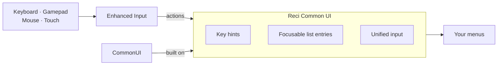

# Reci Common UI

English · [한국어](README.ko.md)


Reci Common UI is an Unreal Engine plugin built on CommonUI that unifies input and sets out a structure for building game menus.

- **Unified input**: keyboard, gamepad, mouse and touch follow the same hover, focus, selection and confirmation
  rules. Navigation follows Enhanced Input mappings, and key hints show the keys of the device in use.
- **Composer → Screen structure**: one Composer per map owns the Stack and the UI input mapping; each Screen owns only
  its own display, input and initial focus. References point down only, and requests go up through dispatchers. The
  demo is built this way ([SPEC.md](Plugins/ReciCommonUI/SPEC.md#structure)).
- **Focusable list entries**: CommonUI's ListView-based lists recycle entry widgets, so buttons, sliders and dropdowns inside
  an entry cannot take focus. Reci lists keep a live widget for every item, and keep focus when the list is refilled.
- **Demo styles**: text, border and button styles and widgets come with the demo as a starting point. Their theme,
  colours and spacing included, follows Material 3.



For split-screen or modular UI, extend the Composer the way Lyra Starter Game's Primary Game Layout does.

This repository contains the plugin (`Plugins/ReciCommonUI`) and a demo project.

## Modules

Widgets, in two runtime modules:

- **ReciCommonUI** (core): Reci List with the Reci Vertical Box, Reci Horizontal Box and Reci Tile Box layout hosts,
  Reci Scroll Box, Reci Focus Style Button Base, Reci Mapped Key Text, Reci Text Block, Reci Dropdown Base and Reci
  Dropdown Popup, and the Reci UI Input Data class.
- **ReciCommonUIWidgets** (optional): Reci Carousel Scroll Box (looping carousel), Reci Advanced List and Reci Two
  Level List Base. These widgets use only the core's public API.

## Requirements

- Unreal Engine 5.8.
- A C++ project. The plugin ships as source, so the editor compiles it; this needs Visual Studio 2022 with the
  workload **Game development with C++**.
- The CommonUI plugin (it contains the CommonInput module) and the Enhanced Input plugin. Reci Common UI enables both.

## Installation

Copy `Plugins/ReciCommonUI` into your project's `Plugins` folder, then open the `.uproject` and let the editor rebuild
the modules.

## Minimum project setup

- Project Settings > Engine > General Settings > Default Classes > **Game Viewport Client Class** = `CommonGameViewportClient`
  (or a subclass).
- Project Settings > Game > Common Input Settings > Input: **Input Data** = a **Reci UI Input Data** with the click, Back and four
  navigation actions, and **Enable Enhanced Input Support** on.
- Project Settings > Engine > User Interface > Focus > **Render Focus Rule** = `Never`.
- `Config/DefaultEngine.ini`:

  ```ini
  [ConsoleVariables]
  CommonUI.ShouldVirtualAcceptSimulateMouseButton=0
  ```

- A C++ module that uses the widgets depends on `ReciCommonUIWidgets`. Blueprints need nothing.

Project Settings > Plugins > Reci Common UI holds the optional Navigation (Tab Navigation, Stick Dominant Axis) and Motion
settings. [DESIGN.md](Plugins/ReciCommonUI/DESIGN.md) (reference) explains each setting.

## Demo

Open `ReciCommonUIDemo.uproject` and answer **Yes** when the editor asks to rebuild the modules. The editor and the
game start in `/ReciCommonUI/Demo/DemoMap`; press Play. The demo assets are in `Plugins/ReciCommonUI/Content/Demo`
(Content Browser > Settings > Show Plugin Content). The level Blueprint shows `WBP_DemoComposer`, which pushes
`WBP_DemoScreen`. The screen has six tab pages:

- **Lists**: entries whose value changes with −/+ buttons, Left and Right, or a sideways drag, and a button with its
  own key.
- **Choices**: dropdowns built from text and from an enum, and a key-binding row fixed per device.
- **Carousel**: a looping carousel whose selected card grows.
- **Grid**: a Multi selection Tile Box whose tiles toggle with Accept or a click.
- **Modal**: a button that asks the Composer to show an Is Modal dialog on its `ModalStack`; the dialog is its own Back
  handler.
- **Two-Level**: categories with a child carousel each; On Confirmed shows the pair.

## Docs

- [Guide](Docs/Guide.md): starting from an empty C++ project, build a menu screen step by step in the Unreal Editor:
  input, item data, widgets, a Screen with a Reci List, its Composer and map, then a check in Play In Editor.
- [SPEC.md](Plugins/ReciCommonUI/SPEC.md): what the plugin provides, under the editor's names, and how to assemble UI
  with it. Written for people and AI agents.
- [DESIGN.md](Plugins/ReciCommonUI/DESIGN.md) (Korean, reference): the design rules behind the plugin and their reasons,
  for changing the plugin itself.

## License

MIT. See [Plugins/ReciCommonUI/LICENSE](Plugins/ReciCommonUI/LICENSE).
